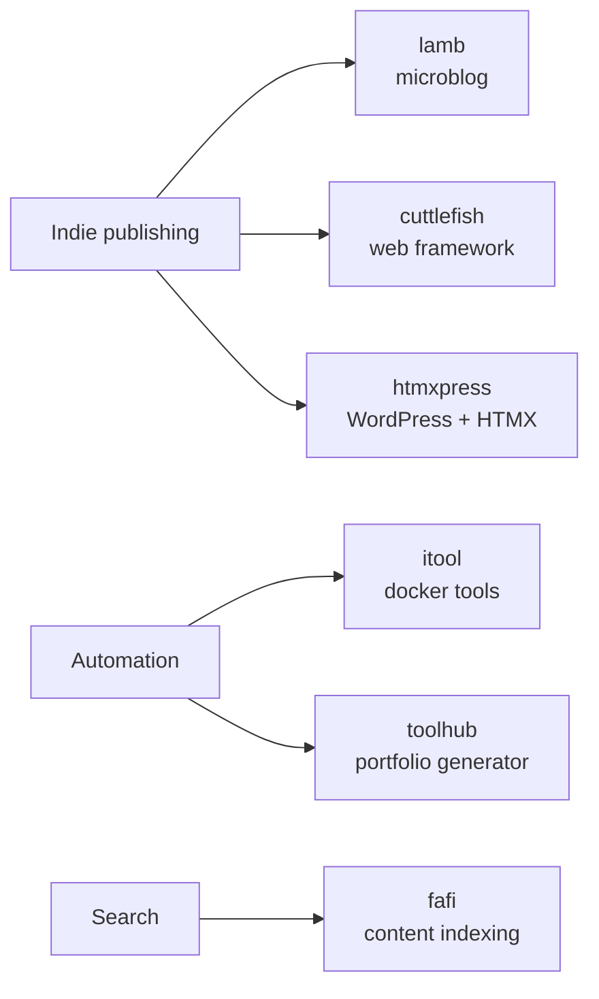

# Hi, I'm Sander 👋

Senior Web Engineer [@humanmade](https://github.com/humanmade). I build tools for indie publishing and the semantic web, mostly in **PHP**, **Python** and **Go** — plus the occasional Godot experiment and a lot of Linux automation.

🌐 [vandragt.com](https://vandragt.com) · 🐘 [micro.blog/sander](https://micro.blog/sander)

---

### 🚀 Latest releases
<!-- RELEASES-LIST:START -->
- 2026-11-01 — [streamcables v0.3.0](https://github.com/svandragt/streamcables/releases/tag/v0.3.0)
- 2026-11-01 — [fafi 0.3.1](https://github.com/svandragt/fafi/releases/tag/0.3.1)
- 2026-10-30 — [park v1.2.0](https://github.com/svandragt/park/releases/tag/v1.2.0)
- 2026-10-28 — [vivace v0.23.0](https://github.com/svandragt/vivace/releases/tag/v0.23.0)
- 2026-10-27 — [lamb 0.15.0-rc2](https://github.com/svandragt/lamb/releases/tag/0.15.0-rc2)
<!-- RELEASES-LIST:END -->

---

### 📡 Latest from my blog
<!-- BLOG-POST-LIST:START -->
- 2026-11-01 — [Diff explanations for GitHub pull requests, powered by LLM. v0.1.0 #projects #diffsplainer](https://vandragt.com/status/929)
- 2026-11-01 — [DailyFeed now has a what’s new page. It has an Atom feed. And a button to follow it with #DailyFeed , if you’re signed in.](https://vandragt.com/status/928)
- 2026-11-01 — [Quick tip: you can finally share emails to Reminders or other apps in iOS 27 if you have Siri AI enabled and available. To do this, ask for summary on…](https://vandragt.com/status/927)
- 2026-10-28 — [Created a fun real time walkie talkie app https://svandragt.github.io/over-and-out/ share a link with someone and get vintage realtime communication l…](https://vandragt.com/status/926)
- 2026-10-28 — [Got some items to sell? Build out a tinylistings instance and send some more eyes to your eBay listings. Demo: https://listings.vandragt.com/ . v1.0 j…](https://vandragt.com/status/925)
<!-- BLOG-POST-LIST:END -->

---

### 🛠️ What I'm building

<b>📚 Publishing tools</b>

- [lamb](https://github.com/svandragt/lamb) — Literally Another Micro Blog
- [cuttlefish](https://github.com/svandragt/cuttlefish) — hackable web framework (WIP)
- [htmxpress](https://github.com/svandragt/htmxpress) — power WordPress with HTMX

<b>⚙️ Automation &amp; tooling</b>

- [itool](https://github.com/svandragt/itool) — local internal docker tools runner
- [toolhub](https://github.com/svandragt/toolhub) — generate a portfolio hub from your repos and gists
- [fafi](https://github.com/svandragt/fafi) — web content indexing and search (Go)

---

### 📊 Stats

---

