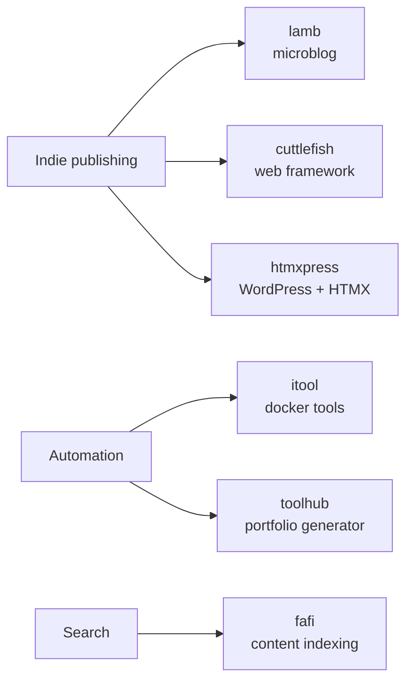

# Hi, I'm Sander 👋

Senior Web Engineer [@humanmade](https://github.com/humanmade). I build tools for indie publishing and the semantic web, mostly in **PHP**, **Python** and **Go** — plus the occasional Godot experiment and a lot of Linux automation.

🌐 [vandragt.com](https://vandragt.com) · 🐘 [micro.blog/sander](https://micro.blog/sander)

---

### 🚀 Latest releases
<!-- RELEASES-LIST:START -->
- 2026-11-21 — [park v1.3.0](https://github.com/svandragt/park/releases/tag/v1.3.0)
- 2026-11-14 — [lamb 0.16.0](https://github.com/svandragt/lamb/releases/tag/0.16.0)
- 2026-11-01 — [streamcables v0.3.0](https://github.com/svandragt/streamcables/releases/tag/v0.3.0)
- 2026-11-01 — [fafi 0.3.1](https://github.com/svandragt/fafi/releases/tag/0.3.1)
- 2026-10-28 — [vivace v0.23.0](https://github.com/svandragt/vivace/releases/tag/v0.23.0)
<!-- RELEASES-LIST:END -->

---

### 📡 Latest from my blog
<!-- BLOG-POST-LIST:START -->
- 2026-11-20 — [The website for Folio is live: Markdown tasks, with a live preview. https://folio.vandragt.com/ Write markdown in the editor and the rendered task lis…](https://vandragt.com/status/940)
- 2026-11-20 — [Also just made this index of my github pages projects, see if you recognise it https://svandragt.github.io/](https://vandragt.com/status/939)
- 2026-11-20 — [https://svandragt.github.io/park/ created a onboarding guide as the GitHub pages to introduce park. Have a loook I’m quite happy](https://vandragt.com/status/938)
- 2026-11-20 — [Race this raid in Bivouac https://svandragt.github.io/bivouac/?seed=311578&tier=continental](https://vandragt.com/status/937)
- 2026-11-20 — [Do you run Lamb?](https://vandragt.com/do-you-run-lamb)
<!-- BLOG-POST-LIST:END -->

---

### 🛠️ What I'm building

<b>📚 Publishing tools</b>

- [lamb](https://github.com/svandragt/lamb) — Literally Another Micro Blog
- [cuttlefish](https://github.com/svandragt/cuttlefish) — hackable web framework (WIP)
- [htmxpress](https://github.com/svandragt/htmxpress) — power WordPress with HTMX

<b>⚙️ Automation &amp; tooling</b>

- [itool](https://github.com/svandragt/itool) — local internal docker tools runner
- [toolhub](https://github.com/svandragt/toolhub) — generate a portfolio hub from your repos and gists
- [fafi](https://github.com/svandragt/fafi) — web content indexing and search (Go)

---

### 📊 Stats

---

