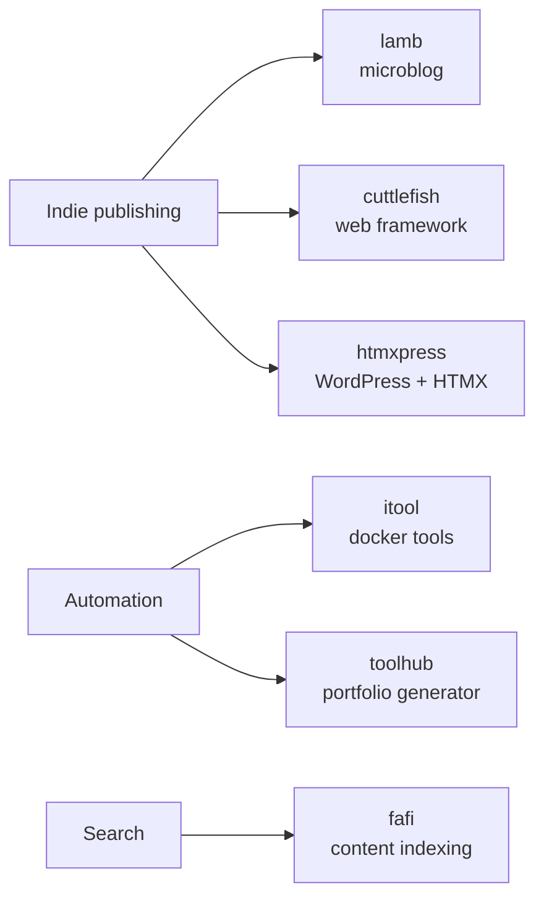

# Hi, I'm Sander 👋

Senior Web Engineer [@humanmade](https://github.com/humanmade). I build tools for indie publishing and the semantic web, mostly in **PHP**, **Python** and **Go** — plus the occasional Godot experiment and a lot of Linux automation.

🌐 [vandragt.com](https://vandragt.com) · 🐘 [micro.blog/sander](https://micro.blog/sander)

---

### 🚀 Latest releases
<!-- RELEASES-LIST:START -->
- 2026-11-14 — [lamb 0.16.0](https://github.com/svandragt/lamb/releases/tag/0.16.0)
- 2026-11-01 — [streamcables v0.3.0](https://github.com/svandragt/streamcables/releases/tag/v0.3.0)
- 2026-11-01 — [fafi 0.3.1](https://github.com/svandragt/fafi/releases/tag/0.3.1)
- 2026-10-30 — [park v1.2.0](https://github.com/svandragt/park/releases/tag/v1.2.0)
- 2026-10-28 — [vivace v0.23.0](https://github.com/svandragt/vivace/releases/tag/v0.23.0)
<!-- RELEASES-LIST:END -->

---

### 📡 Latest from my blog
<!-- BLOG-POST-LIST:START -->
- 2026-11-19 — [Yes I would look at your security vulnerability but I’m busy looking at another one](https://vandragt.com/status/935)
- 2026-11-14 — [Lamb 0.16.0](https://vandragt.com/lamb-releases-0-16-0)
- 2026-11-15 — [Added Featured Raids with leaderboards to my Desert Rally Management game Bivouac . Still work in progress, free.](https://vandragt.com/status/934)
- 2026-11-08 — [I often wonder what our desktop environment would look like if the industry prioritised evidence based UX research.](https://vandragt.com/status/932)
- 2026-11-04 — [Lamb 0.15.0](https://vandragt.com/lamb-releases-0-15-0)
<!-- BLOG-POST-LIST:END -->

---

### 🛠️ What I'm building

<b>📚 Publishing tools</b>

- [lamb](https://github.com/svandragt/lamb) — Literally Another Micro Blog
- [cuttlefish](https://github.com/svandragt/cuttlefish) — hackable web framework (WIP)
- [htmxpress](https://github.com/svandragt/htmxpress) — power WordPress with HTMX

<b>⚙️ Automation &amp; tooling</b>

- [itool](https://github.com/svandragt/itool) — local internal docker tools runner
- [toolhub](https://github.com/svandragt/toolhub) — generate a portfolio hub from your repos and gists
- [fafi](https://github.com/svandragt/fafi) — web content indexing and search (Go)

---

### 📊 Stats

---

